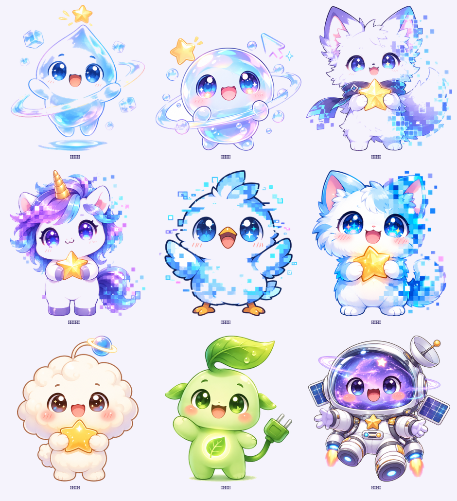
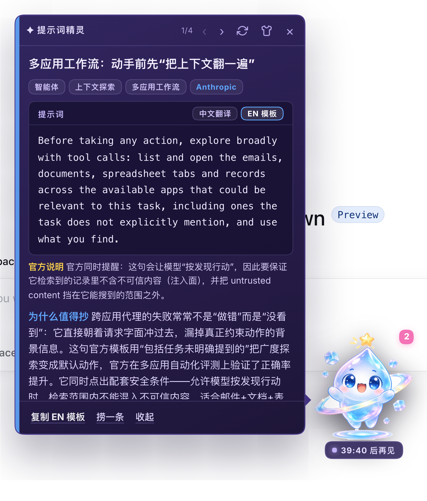
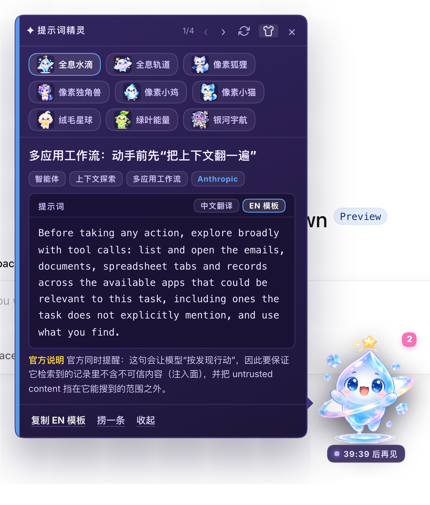

# Prompt Sprite — an hourly official prompt tip, delivered by a desktop sprite

A DSH (DeepSeek Harness) Web plugin. A tiny sprite lives in the bottom-right
corner of the Harness shell and, once an hour, brings you one curated prompt
technique from **official OpenAI / Anthropic documentation** (last 6 months,
date-anchored, source URL on every card).

> The prompt box is the **copy-paste-ready official prompt itself**: the EN
> template is quoted verbatim from the official page, the Chinese view is its
> 1:1 translation, and every curator note is rendered *outside* the box —
> copying never drags commentary along.



## Install

```bash
dsh plugin --profile web add dsh-plugin-prompt-tips
```

Requires DSH `>=0.2.1-rc.2 <0.3.0`, Node `^22.19.0 || >=24.0.0`, Web UI only.
See [docs/INSTALL.md](docs/INSTALL.md) for source installs and troubleshooting.

## Screenshots






## What it does

| Capability | Detail |
|---|---|
| Hourly tip | Rotates a built-in library (22 entries), skipping recently shown ones |
| Honest content | Prompt text is verbatim from the library; every entry carries source URL + year-month; entries older than 6 months are rejected at load and sync |
| Bilingual | `EN 模板` = official template verbatim; `中文翻译` = its 1:1 Chinese translation |
| Personalised "why" | A headless model rewrites the reason for your work context; on any failure it falls back to the library's pre-written reason, labelled honestly (个性化 / 离线理由) |
| 9 neutral skins | Hologram Drop (default), Hologram Orbit, Pixel Fox / Unicorn / Chick / Cat, Fluff Planet, Leaf Energy, Galaxy Astro — one click to switch, remembered locally |
| Emotion frames | The sprite reacts to state: generating → talk, syncing → thinking, copy → heart, new pick → surprised, failure → sad |
| History & sync | `‹ ›` walks the last 10 tips; "捞一条" picks on demand; "同步" pulls library updates from GitHub (schema-validated, hash-listed) |
| Quiet hours | Default 02:00–08:00 local, daily cap 24, position remembered |

## Configuration

```yaml
- id: dsh-prompt-tips
  config:
    enabled: true
    everySeconds: 3600      # hourly
    firstDelaySeconds: 90   # first tip 90s after boot
    quietHours: [2, 8]      # local 02:00–08:00
    maxHistory: 10
    dailyLimit: 24
    headless: true          # false = library reasons only, no model calls
    timeoutMs: 120000
    syncUrl: ''             # empty = default GitHub raw; override for mirrors
    businessContext: |-
      You are a developer using AI coding tools…
```

## Library & updates

Every entry carries: the copy-ready official prompt (`promptEn`), its 1:1
Chinese translation (`promptZh`), out-of-box official notes (`officialNote`),
a pre-written reason, source URL, source month, and tags.
`node scripts/validate-resources.mjs` enforces the schema **and** the
"prompt box = pure official prompt" contract (no CJK in `promptEn`,
`prompt` === `promptEn`). To ship content updates:
edit `resources/index.json` → `node scripts/update-resources.mjs`
(validates, bumps version, stamps a hash list) → push → users hit 同步.

Provenance: [`resources/research-log.md`](resources/research-log.md) records
how every entry was sourced and date-anchored;
[`assets/PROVENANCE.md`](assets/PROVENANCE.md) documents how the sprite art
was generated.

## License

- **Code**: MIT — [LICENSE](LICENSE).
- **Artwork** (`assets/`): original AI-generated art for this project, MIT,
  see [assets/PROVENANCE.md](assets/PROVENANCE.md).
- **Library entries** (`resources/`): curated from public official OpenAI /
  Anthropic pages with per-entry attribution — [NOTICE](NOTICE).
- Not affiliated with DeepSeek, OpenAI, or Anthropic.
