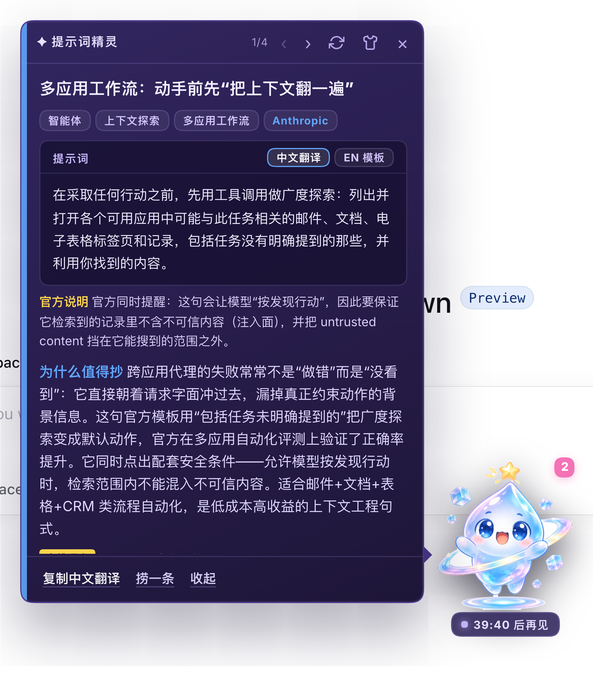
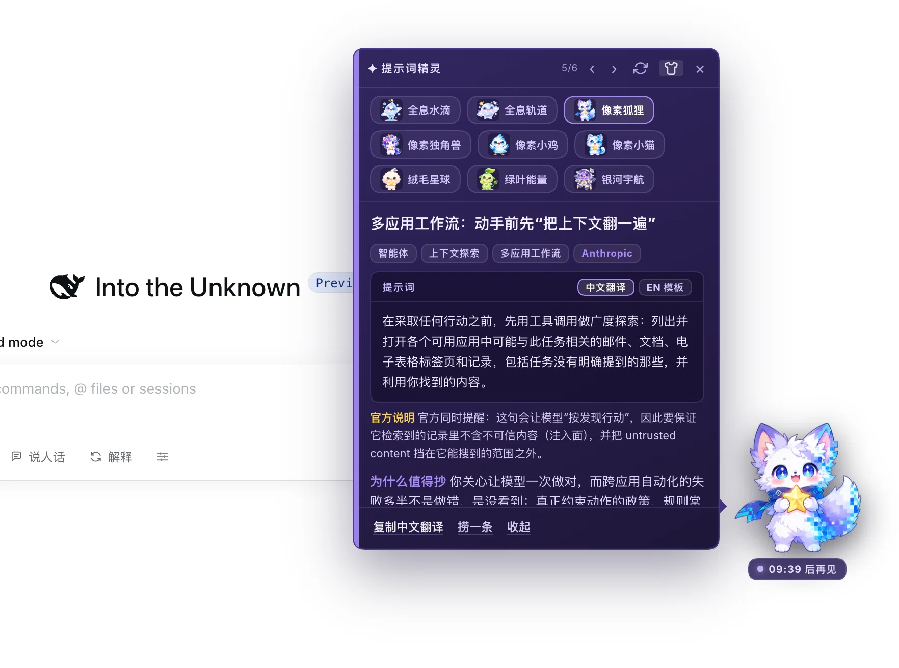
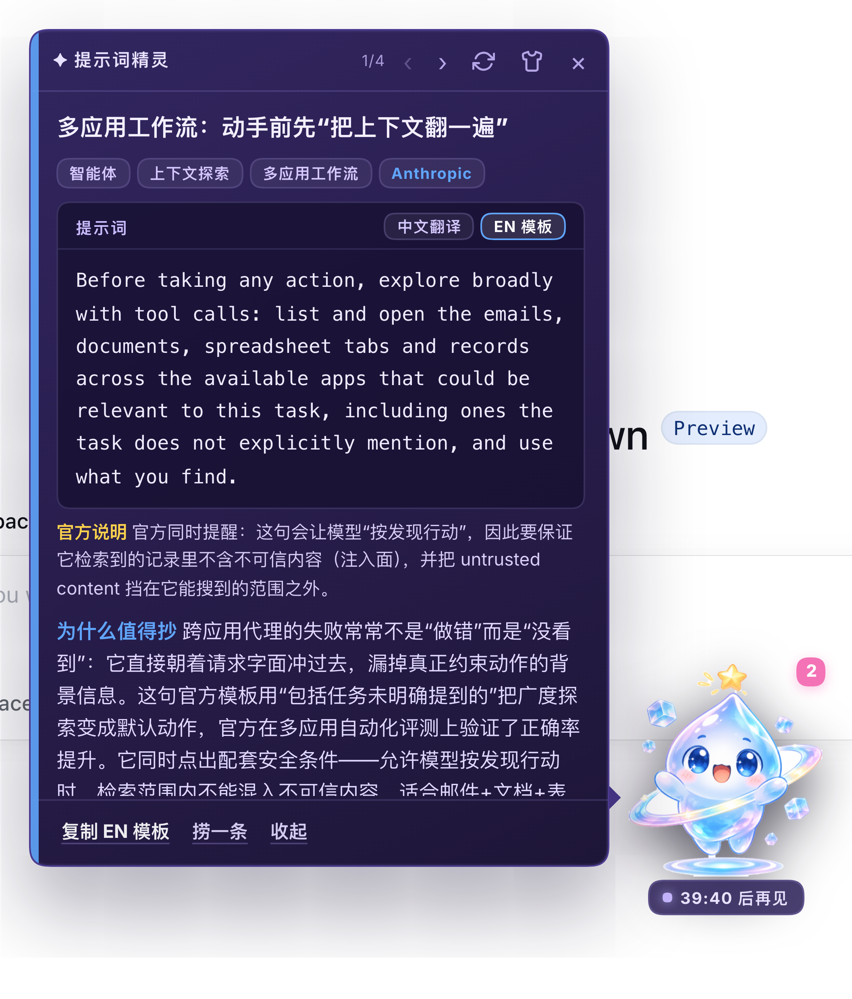
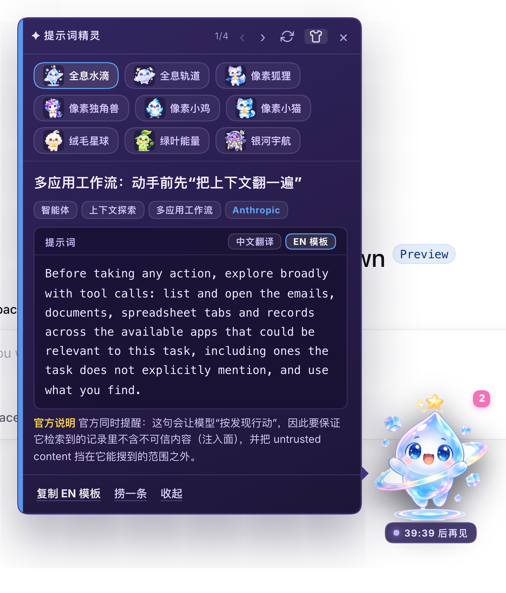

# Prompt 小精灵 —— 住在 DSH 右下角、每小时送你一条官方 prompt 技巧的小精灵

「提示词框 = 可以直接复制粘贴的官方提示词本体」：EN 模板逐字来自官方页面，
中文视图是它的 1:1 翻译，官方说明与整理注一律在框外，复制绝不夹带杂质。

星尘气泡 + 九套可换的教师立绘；每条推荐 = **官方原版 prompt（一键复制，
EN 模板）** ＋ **它的 1:1 中文翻译** ＋ **为什么值得抄（模型个性化）** ＋
**来源与日期（可回溯）**。所有内容整理自
OpenAI / Anthropic 官方近 6 个月的公开资料，过旧的条目会被校验直接拒绝。

## 安装

```bash
dsh plugin --profile web add dsh-plugin-prompt-tips
```

装完按 **Ctrl+C 停掉 `dsh web`，再重新 `dsh web`**，刷新页面——右下角就有小精灵了。

- 要求：DSH `>=0.2.1-rc.2 <0.3.0`、Node `^22.19.0 || >=24.0.0`，仅 Web 界面；
- 从源码安装、卸载、排错：[docs/INSTALL.md](docs/INSTALL.md)。

## 界面截图









## 小精灵


九套**中性无性别**小精灵：全息水滴（默认）、全息轨道、像素狐狸、像素独角兽、
像素小鸡、像素小猫、绒毛星球、绿叶能量、银河宇航——全部 gpt-image 生成、
透明底高清立绘。点气泡里的**换肤**即可切换，选择会被记住。

「全息水滴」内置完整 **9 帧情绪**：待机 / 大笑（同步成功）/ 说话（生成中）/
思考（同步中）/ 惊喜（捞到新推荐）/ 委屈（同步失败）/ 比心（复制成功）/
打盹（免打扰时段）/ 挥手（换肤问候）——状态自动切换，实时反映插件在干什么。
素材声明见 [assets/PROVENANCE.md](assets/PROVENANCE.md)。

## 它能做什么

| 能力 | 说明 |
|---|---|
| **每小时推荐一条** | 内置资源库（≥15 条官方技巧）轮转挑一条最近没推过的；启动 90s 后先来一次 |
| **只讲官方内容的真话** | prompt 正文逐字来自资源库并带来源 URL + 年月；整理自 OpenAI / Anthropic 官方近 6 个月资料，`2026-05` 更早的条目在加载与同步两处都会被校验拒绝 |
| **为什么值得抄** | 默认接模型（`headless`）按你的工作背景个性化改写；没凭据 / 超时 / 输出异常时自动降级为资料库预写理由，气泡明确标注「个性化」还是「离线理由」，不冒充 |
| **换肤** | 9 套中性小精灵，点击即换、本地记忆；新增 IP 一条命令：`skill/mascot-emo` |
| **翻历史** | `‹ ›` 上一条 / 下一条，缓存硬上限 10 条（第 11 条挤掉最旧一条） |
| **捞一条** | 不等整点，随时手动捞一条新推荐 |
| **同步更新** | 仓库侧更新资料后，用户点击「同步」即可拉取新版（schema 校验先行，非法数据绝不落盘）；同步结果展示版本号变化 |
| **不打扰** | 免打扰时段（默认 02:00–08:00）、每日上限（默认 24 条）、位置本地记忆、打开即已读 |

## 配置

```yaml
- id: dsh-prompt-tips
  config:
    enabled: true
    everySeconds: 3600      # 每小时
    firstDelaySeconds: 90   # 启动后 90s 先来一次
    quietHours: [2, 8]      # 本地时间 02:00–08:00 不打扰
    maxHistory: 10          # 历史硬上限
    dailyLimit: 24
    headless: true          # false = 只用资料库预写理由，不花模型调用
    timeoutMs: 180000       # headless 子进程超时；超时只会放弃本轮并降级
    modelHint: ''           # 可选：约束个性化理由的语言风格，如「直接、少废话」
    syncUrl: ''             # 空 = 默认 GitHub raw；私有镜像可覆盖
    syncTimeoutMs: 30000
    businessContext: |-
      用户是一位使用 AI 编程工具的开发者……
```

## 资源库与更新

- 每条条目含：可复制 prompt 模板（`promptEn`，纯官方提示词）、它的 1:1 中文
  翻译（`promptZh`）、框外官方说明（`officialNote`）、预写推荐理由、来源 URL、
  来源年月、标签；独立校验脚本 `node scripts/validate-resources.mjs`
  （会强制 promptEn 无中文、prompt 与 promptEn 一致）；
- 我们定期更新：改 `resources/index.json` → `node scripts/update-resources.mjs`
  （校验 + 版本号递增 + 内容哈希清单）→ push GitHub → 用户端「同步」即生效；
- GitHub raw 有约 5 分钟 CDN 缓存，同步结果展示远端版本号供核对；
- 版权与来源声明见 [NOTICE](NOTICE) 与抓取记录 [resources/research-log.md](resources/research-log.md)。

## 已知限制

- 只支持 Web 界面（`dsh.client.platform: web`），终端 / TUI 里没有精灵；
- 定时器只在这个 `dsh web` 进程活着时走；进程停了不会补跑，重启后按
  `nextRunAt` 决定是否补一次；
- headless 生成每次是独立会话（不复用上下文）：为避免重复，prompt 模板里
  带最近 6 条已推荐标题。

## License

- **代码**：MIT，见 [LICENSE](LICENSE)。
- **立绘与图标**（`assets/`）：本项目原创自绘，MIT 同授权范围，声明见
  [assets/PROVENANCE.md](assets/PROVENANCE.md)。
- **资源库条目**（`resources/`）：整理自 OpenAI / Anthropic 官方公开页面，
  逐条保留来源，详见 [NOTICE](NOTICE)。
- 本项目与 DeepSeek、OpenAI、Anthropic 均无隶属关系。

---

包名 `dsh-plugin-prompt-tips` · 技术细节（架构、接口契约、验证方式）见
[docs/](docs/)：[API-CONTRACT.md](docs/API-CONTRACT.md) · [INSTALL.md](docs/INSTALL.md)
